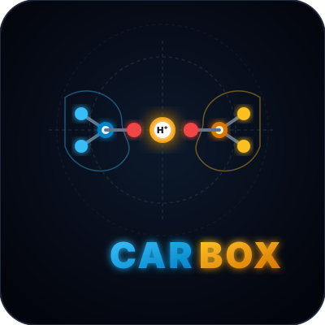

# Carbox — Macromolecular Crystallographic Validation Platform

<p align="center">
  
</p>

<p align="center">
  <strong>Structural Identification of Anomalous Carboxyl Protonation States, Low-Barrier Hydrogen Bonds, and Microenvironment Dielectric Shielding</strong>
</p>

<p align="center">
  <a href="https://project-carbox.github.io/carbox.github.io/"></a>
  <a href="https://colab.research.google.com/github/project-carbox/carbox/blob/main/notebooks/Carbox_Garib_Murshudov_4Stages_Colab.ipynb"></a>
  <a href="mailto:suleyman.hacizade1@gmail.com?subject=Private%20Data%20%26%20Repository%20Access%20Request%20-%20Project%20Carbox"></a>
  <a href="mailto:suleyman.hacizade1@gmail.com"></a>
  <a href="https://github.com/project-carbox/carbox"></a>
</p>

---

> [!IMPORTANT]
> ### 🔒 Private Data & Repository Access Notice (Məxfi Məlumatlar və Giriş İcazəsi)
> **English:** All raw crystallographic datasets, full 7,230-PDB screening matrices, electron density correlation profiles ($2mF_o - DF_c$), backend computational pipelines, and manuscript drafts housed in **`project-carbox/carbox`** are **strictly private**. If you are an academic researcher, peer reviewer, or institutional collaborator wishing to access the private repository, please contact **Suleiman M Hajizadeh** via email:  
> 📧 **[suleyman.hacizade1@gmail.com](mailto:suleyman.hacizade1@gmail.com?subject=Access%20Request%20-%20Project%20Carbox%20Private%20Data%20%26%20Repository)**
>
> **Azərbaycanca:** Bu tədqiqat platformasındakı bütün xam kristalloqrafik məlumat bazaları, 7,230 PDB strukturu üzrə tam skrininq matrisaları, elektron sıxlığı xəritələri və əsas hesablama boru xətləri (`carbox`) **məxfidir (private)**. Məlumatlara və ya qapalı tədqiqat repozitoriyasına tam giriş əldə etmək üçün elektron poçt vasitəsilə müraciət edə bilərsiniz.

---

## 🔬 Overview

**Carbox** (`project-carbox.github.io`) is the official public web showcase for the Carbox research platform. Designed by **Suleiman M Hajizadeh** in collaboration with **Prof. Garib N Murshudov** (MRC-LMB Cambridge), this portal presents a rigorous crystallographic validation framework engineered to distinguish genuine shared-proton Low-Barrier Hydrogen Bonds (LBHBs) from refinement artifacts, thermal disorder, and unmodeled cation complexes across the Protein Data Bank (PDB).

> *"If there is no electron density for atoms, they are mismodeled. If atoms are mismodeled, the distance between them is completely meaningless."*  
> — **Prof. Garib N Murshudov**, MRC Laboratory of Molecular Biology (Cambridge)

---

## 🚀 Key Showcase Features

1. **The 4-Stage Precision Protocol**:
   - **Stage 1 (Geometric Mining & Burial)**: Euclidean distance scanning ($d(O \cdots O) \le 3.20$ Å, LBHB cutoff $\le 2.55$ Å) and solvent exclusion ($d(\text{water}) > 3.0$ Å).
   - **Stage 2 (Non-Parametric Pruning)**: Dual-tier filtering using non-parametric Tukey Interquartile Range (IQR, $\alpha \in \{1.5, 3.0\}$) on atomic $B$-factors and Fisher $z$-transformed Real-Space Correlation Coefficients (RSCC).
   - **Stage 3 (Biochemical Protonation Modeling)**: PROPKA 3 integration measuring electrostatic $\Delta \text{p}K_a \ge +2.0$ shifts in low dielectric pockets ($\varepsilon \approx 2\text{--}4$).
   - **Stage 4 (Golden Benchmark Library)**: Direct validation against 10–20 universally accepted catalytic and structural LBHBs before batch scaling.
2. **Interactive 3D Molecular Graphics**:
   - In-browser WebGL rendering using **3Dmol.js** (zero server requirements, lightweight, fast loading).
   - Interactive presets for `1KZK` (HIV-1 Protease), `1OEW` (Endothiapepsin), `2DSX` (Rubredoxin), and `1FKN` (BACE-1).
3. **Filterable Golden Benchmarks Table**:
   - Real-time search and filtering for sub-angstrom and atomic-resolution structures.
4. **Zero-Dependency Static Architecture**:
   - 100% static client-side frontend (HTML5, modern CSS3 Glassmorphism, Vanilla ES6+ JS).
   - Instant deployment on GitHub Pages.

---

## 👥 Scientific Leadership & Affiliations

- **Suleiman M Hajizadeh**  
  *Institute of Molecular Biology, Ministry of Science and Education of the Republic of Azerbaijan*  
  *Western Caspian University, Baku, Azerbaijan*

- **Garib N Murshudov**  
  *MRC Laboratory of Molecular Biology (LMB), Cambridge Biomedical Campus, Cambridge, United Kingdom*

---

## 📖 Citation

If you use the Carbox platform, benchmark datasets, or methodology in your research, please cite:

```bibtex
@article{HajizadehMurshudov2026,
  author    = {Hajizadeh, Suleiman M and Murshudov, Garib N},
  title     = {Structural Identification of Anomalous Carboxyl Protonation States,
               Low-Barrier Hydrogen Bonds, and Microenvironment Dielectric Shielding
               in High-Resolution Protein Crystal Structures},
  journal   = {Carbox & CarboxMol Macromolecular Crystallography Suite},
  year      = {2026},
  volume    = {0},
  number    = {4},
  pages     = {1--35},
  publisher = {Project Carbox},
  url       = {https://project-carbox.github.io/}
}
```

---

## 🔗 Related Repositories

- **Core Engine & Colab Notebook**: [`project-carbox/carbox`](https://github.com/project-carbox/carbox)
- **Desktop 3D Electron Density Suite**: [`carboxmol/carboxmol`](https://github.com/carboxmol/carboxmol)
- **Project Organization**: [`project-carbox`](https://github.com/project-carbox)
